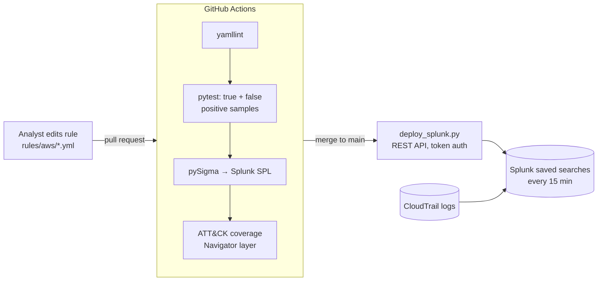

# Detection-as-Code Pipeline (Sigma → tests → Splunk)


AWS threat detections managed like software: every rule lives in Git, ships with true-positive and false-positive samples, is unit-tested on every pull request, converted to Splunk SPL by pySigma, mapped to MITRE ATT&CK, and deployed to Splunk as scheduled saved searches on merge.

**Problem:** detections edited by hand in a SIEM break silently, nobody can prove coverage, and a bad edit can blind the SOC. **Outcome:** a broken rule fails the pull request before it reaches production, and coverage is a generated report, not a guess.

## How it works



## Rules (AWS CloudTrail)

| Rule | ATT&CK | Level |
| --- | --- | --- |
| CloudTrail logging stopped or deleted | T1562.008 | high |
| Root account console login | T1078.004 | high |
| IAM access key created for another user | T1098.001 | medium |
| GuardDuty detector deleted or disabled | T1562.001 | high |
| S3 public access block removed | T1530 | high |
| Console login without MFA | T1078.004 | medium |
| EC2 user data modified | T1059 | medium |
| Secrets Manager values read from console | T1555.006 | low |

8 rules, 7 techniques, 17 tests. The coverage table is regenerated on every run and shown on the workflow summary page.

## Run locally

```bash
python -m venv .venv && source .venv/bin/activate   # Windows Git Bash: .venv/Scripts/activate
pip install -r requirements.txt
make all        # pytest, convert to SPL, ATT&CK coverage
```

Outputs land in `build/`: `splunk/*.spl`, `attack-layer.json` (load it at mitre-attack.github.io/attack-navigator), `coverage.md`.

## Deploy to Splunk (optional)

Create a GitHub environment named `splunk` with secrets `SPLUNK_URL` (`https://your-stack:8089`) and `SPLUNK_TOKEN`. Merges to `main` create or update saved searches named `DaC - <rule>`. Without the secrets the deploy step skips cleanly, so forks and pull requests never touch Splunk.

## Add a rule

1. Copy a rule in `rules/aws/`, give it a new UUID, ATT&CK tag and level.
2. Add `tests/samples/<rule>.json` with `should_match` and `should_not_match` events.
3. Open a pull request. CI refuses a rule without samples or an ATT&CK tag.

## A real catch from building this

The first version of the access-key rule compared two fields (`requestParameters.userName` against `userIdentity.userName`). The tests passed, but CI's Splunk conversion failed: Splunk's backend cannot negate a field-to-field comparison. The fix used CloudTrail's own behavior instead: when users create a key for themselves, `requestParameters.userName` is absent. The pipeline caught a production-breaking rule before deploy, which is the point of the project.

Design decisions and trade-offs: [docs/design-decisions.md](docs/design-decisions.md).
